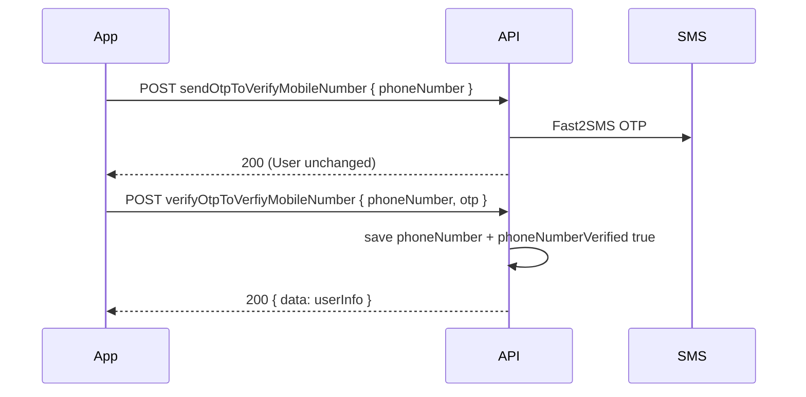

# Backend handoff — Profile verification & auth (JJ_Frontend)

**Date:** 2026-06-03 (updated 2026-06-03 — profile phone OTP-only save)  
**Frontend repo:** JJ_Frontend  
**Backend repo:** JJ_Backend  
**Audience:** JJ_Backend  
**Priority:** P0  
**API base (local):** `http://localhost:8000/api/user`

---

## Summary

Frontend profile/settings verification UI depends on consistent `userInfo` fields and explicit **OTP-only** phone save. Phone is shown on profile **only when verified**. No new OTP route paths — contract changes on existing endpoints.

---

## 1. `signupMethod` on every `userInfo`

```json
"signupMethod": "email" | "phone"
```

- `"email"` — email or Google/Apple signup
- `"phone"` — `POST /signUp` with `phoneNumber`

Returned on all auth/profile responses via `toUserInfo()`.

---

## 2. Verification booleans

| Field | Rule |
|-------|------|
| `emailVerified` | `true` after email OTP or social login |
| `phoneNumberVerified` | `true` only when `phoneNumber` saved **and** mobile OTP completed |

**Never** return `phoneNumberVerified: true` without `phoneNumber` (enforced in model + `toUserInfo()`).

---

## 3. Phone OTP — send vs verify (critical contract)

| Step | Endpoint | Backend must |
|------|----------|--------------|
| **Send OTP** | `POST /sendOtpToVerifyMobileNumber` `{ phoneNumber }` | Send SMS only. **Do not** write `phoneNumber` on User. Check number not owned by another user. |
| **Verify OTP** | `POST /verifyOtpToVerfiyMobileNumber` `{ phoneNumber, otp }` | **Only** place that atomically saves `phoneNumber` + sets `phoneNumberVerified: true`. Return `data` = `userInfo`. |
| **Profile update** | `POST /UpdateUserDetails` | **Reject** `phoneNumber` with `400` + `code: "PHONE_USE_OTP_FLOW"`. |

Email / forgot-password OTP unchanged: `sendOtp` / `verifyOtp`.

---

## 4. Profile phone flow + UpdateUserDetails policy

### Profile UI (frontend)

- Per-field edit: name, username, gender, birthday, avatar
- Phone: **Add phone number** row → `AddPhoneNumber` → OTP screen → verified badge
- Phone visible on profile **only when** `phoneNumberVerified === true`

### Backend sequence

```
User taps Add phone → enter number
  → POST sendOtpToVerifyMobileNumber   (SMS only, no User.phoneNumber write)
  → user enters OTP
  → POST verifyOtpToVerfiyMobileNumber (saves phone + verified, returns userInfo)
  → profile shows verified phone
```

### UpdateUserDetails

Accepts: `firstName`, `lastName`, `userName`, `gender`, `birthdate`, `avatar`, `address`, `email` — **not** `phoneNumber`.

If `phoneNumber` is sent:

```json
{
  "message": "Phone number cannot be saved via UpdateUserDetails. Use sendOtpToVerifyMobileNumber, then verifyOtpToVerfiyMobileNumber.",
  "code": "PHONE_USE_OTP_FLOW"
}
```

---

## 5. Sign-in & sign-up

### `POST /signIn`

Email **or** `phoneNumber` + `password` (not both).

### `POST /signUp`

Email **or** `phoneNumber` + password. Phone signup sets `signupMethod: "phone"`, stores `phoneNumber`, `phoneNumberVerified: false` until OTP verify (sign-in works before verify).

### Social login

Google/Apple → `signupMethod: "email"`, `emailVerified: true`, `googleAuthId` / `appleAuthId` in `userInfo`.

### `GET /password-settings`

```json
{ "authProvider": "google" | "apple" | "email", "canChangePassword": true | false }
```

---

## 6. OTP endpoint reference

| Purpose | Send | Verify |
|---------|------|--------|
| Email / forgot password | `POST /sendOtp` `{ contact }` | `POST /verifyOtp` `{ contact, otp }` |
| Phone (profile) | `POST /sendOtpToVerifyMobileNumber` | `POST /verifyOtpToVerfiyMobileNumber` |

---

## 7. Invariants

1. App access requires only signup-method contact verified.
2. Other contact optional — add/verify from profile later.
3. **Profile phone:** never on User until verify OTP succeeds.
4. **Profile display:** frontend shows phone only when `phoneNumberVerified === true` (keep `hasProfilePhone` guard).
5. `otpSkipped` must not imply verified without a saved phone.
6. Phone signup (`signupMethod: "phone"`) may hold unverified `phoneNumber` for login until OTP completes.

---

## 8. Product rules

1. Signup-method contact must be verified for full app access.
2. Secondary contact added via profile OTP flows.
3. No “save phone first, verify later” via UpdateUserDetails.

---

## 9. Implementation reference

| File | Role |
|------|------|
| `src/controllers/SmsOtp.js` | Send = SMS only; verify = atomic phone save |
| `src/controllers/UserInfoController.js` | Rejects `phoneNumber` on UpdateUserDetails |
| `src/utils/userInfo.js` | `toUserInfo()` serializer |
| `src/models/User.js` | `signupMethod`; phone/verified invariant |
| `scripts/migrate-profile-verification.js` | Legacy data cleanup |

---

## 10. QA checklist — OTP-only phone save

- [ ] `sendOtpToVerifyMobileNumber` — User doc unchanged (no `phoneNumber` before verify)
- [ ] `verifyOtpToVerfiyMobileNumber` — returns `data.phoneNumber` + `data.phoneNumberVerified: true`
- [ ] `UpdateUserDetails` with `phoneNumber` → `400` + `PHONE_USE_OTP_FLOW`
- [ ] Profile: no phone row until verified (frontend + API)
- [ ] Duplicate phone on another account → `409` on send and verify
- [ ] Re-login: verified phone persists in `userInfo`
- [ ] Phone signup (`signUp` + phone) still works; verify upgrades `phoneNumberVerified`

Postman samples: [PROFILE_VERIFICATION_POSTMAN.md](./PROFILE_VERIFICATION_POSTMAN.md)

---

## 11. Migration

```bash
npm run migrate:profile-verification        # dry-run
npm run migrate:profile-verification:apply  # apply
```

| Rule | Action |
|------|--------|
| No `phoneNumber` | `phoneNumberVerified = false` |
| `otpSkipped` without phone | `phoneNumberVerified = false`, unset `otpSkipped` |
| Google/Apple + email | `signupMethod = email`, `emailVerified = true` |
| Missing `signupMethod` | default `email` |
| **OTP-only save (new)** | Email-signup users with unverified `phoneNumber` → unset `phoneNumber` (keeps phone-signup accounts) |

---

## 12. Deploy & frontend unlock

**Local first** — staging after local QA passes.

| Step | Action |
|------|--------|
| 1 | `npm run dev` (port 8000) |
| 2 | `npm run migrate:profile-verification:apply` |
| 3 | Ping frontend with local URL |

---

## 13. Local QA phases

**Ping template:**

```
Local API live: http://localhost:8000/api/user
Migration applied: yes (migrate:profile-verification:apply)
Ready for Phase A QA.
```

| Phase | Work |
|-------|------|
| **A** | Profile QA — Google / email / legacy; Add phone → OTP |
| **B** | Drop fallbacks in `profileContactDisplay.ts`, `session.ts` when `userInfo` clean |
| **C** | Phone signup UI on `Signup.tsx` after `POST /signUp` + `phoneNumber` confirmed |

**Frontend keeps:** `hasProfilePhone` guard.

---

## 14. Changelog — profile phone OTP-only save

### What changed (2026-06-03)

| Before | After |
|--------|-------|
| UpdateUserDetails could save phone, reset verified | UpdateUserDetails **rejects** phoneNumber |
| Ambiguous when phone appears on profile | Phone saved **only** on verify OTP |
| Send OTP might imply pending phone on user | Send OTP = **SMS only** |

### Sequence



### Backend action items (done)

- [x] Send OTP does not write `phoneNumber` on User
- [x] Verify OTP atomically saves phone + sets verified; returns `data`
- [x] UpdateUserDetails rejects `phoneNumber` (`PHONE_USE_OTP_FLOW`)
- [x] Migration rule 7: clear unverified phone on email-signup users

### Out of scope

- Server-backed notification mute
- Staging deploy gate (local-first workflow)
